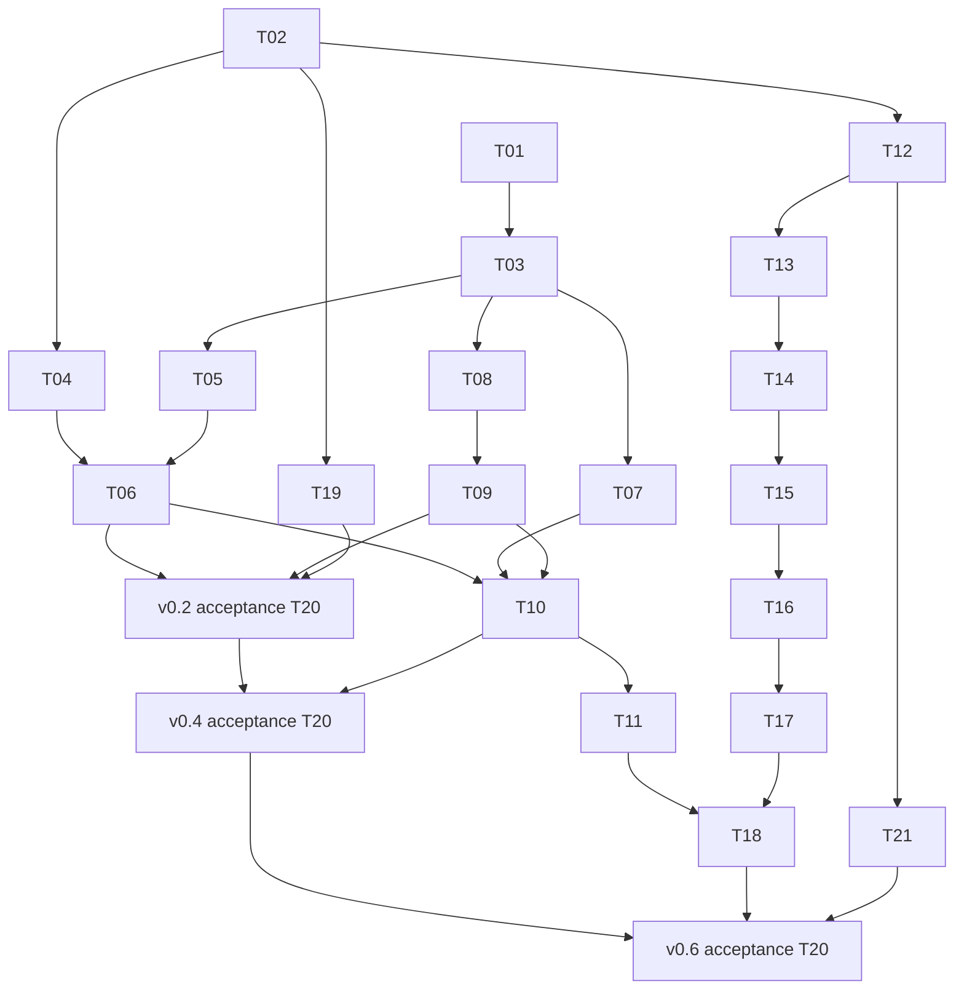

# Implementation schedule and handoff protocol

Read [the audit](CURRENT-STATE-2026-11-13.md) and [task definitions](IMPLEMENTATION-PLAN.md) first. This is an estimated delivery schedule, not a scheduled automation or a promise that external acceptance will happen on a particular date.

## Capacity and assumptions

Planning start: Monday **16 November 2026**, or the next agreed working day. One implementer works sequentially, with an experienced reviewer available for PDF removal, lifecycle changes and the digital-seal boundary. No concurrent agents are assumed. A focused day is 4–6 hours of implementation, testing, evidence and review corrections; model runtime is not equivalent to a completed engineering day.

Core T01–T19 plus T21 planning is approximately **62–103 focused days** from the task-card ranges. Budget T20 acceptance at 2–4 active days for each of three milestones, for **68–115 days total** before external waiting. A **24-week working plan**, with **up to six further contingency weeks**, is appropriate for a single implementer. This is an estimate, not confidence that secure removal is feasible within that period. T12/T13 are go/no-go decisions; a failed removal investigation requires replanning rather than a date-driven unsafe implementation.

Windows hardware, real printers, representative documents, native build access and owner acceptance can extend elapsed time. Holidays and availability are not inferred. Start requesting access and booking manual sessions in week 1. Bring a ready independent task forward when hardware blocks another; never record a pending task as complete to preserve the calendar.

## Baseline sequence

| Window | Nominal dates | Tasks and deliverable | Exit/replanning gate |
| --- | --- | --- | --- |
| W1 | Nov 16–20, 2026 | T01 public test portability; T02 documentation reconciliation; provision existing build/validation access | Reproducible baseline, corrected status, no private tooling required for public unit tests |
| W2 | Nov 23–27 | T03 helper hangs/resource limits; T04 compact controls begins | Failure injection is bounded; preserve successful paths |
| W3–W4 | Nov 30–Dec 11 | Finish T04; T05 performance baseline and high-zoom tiles | Geometry, responsive input and measured memory/latency gates |
| W5 | Dec 14–18 | T06 native reader input; T19 advisory/pin/packaging inventory begins | Both desktop sessions available; otherwise retain PENDING and move ready backend work forward |
| W6–W7 | Dec 21–Jan 1, 2027 | T08 Windows printing; T09 physical print qualification; T19 package checks | Printer and scale acceptance; holiday availability may shift this window |
| W8 | Jan 4–8 | T20 reader acceptance and fixes; v0.2 candidate dossier | Scenario A, exact-source checks and owner approval; reserved stable version remains with authority |
| W9–W10 | Jan 11–22 | T07 protected secondary page sources and compatibility; T10 marks/recovery/interop | B/C evidence; failure/alias regressions pass |
| W11 | Jan 25–29 | Finish T10; T20 v0.4 acceptance and fixes | Owner B/C acceptance, external-viewer and printed-size receipts |
| W12 | Feb 1–5 | T11 review round-trip/native input | E behavior qualified before adding baking interaction |
| W13 | Feb 8–12 | T12 production removal contract; T21 seal-interface planning | Experienced reviewer approves supported subset and proof strategy; otherwise STOP bake implementation |
| W14–W15 | Feb 15–26 | T13 adversarial fixtures, graph preflight and independent checks | Proof/refusal gate passes; unresolved structures stay unsupported |
| W16–W17 | Mar 1–12 | T14 production backend and failure handling | Source-bound export, independent removal/outside preservation and lifecycle review |
| W18–W19 | Mar 15–26 | T15 region editor; T16 templates/recovery | Geometry, undo and schema compatibility; no secure UI exposure yet |
| W20 | Mar 29–Apr 2 | Finish T16; T17 modes and warnings | Honest capability/refusal UX and cancel behavior |
| W21–W22 | Apr 5–16 | T18 review independence, adversarial/native acceptance, physical quality | Scenario D security review and D/E owner evidence |
| W23–W24 | Apr 19–30 | Finish T19 package/update checks; T20 v0.6 acceptance, fixes and handoff | All mandatory gates for actual candidate, no silent skips; no automatic release |
| Reserve | May 3–Jun 11 | Up to six weeks for failed gates, review revisions and external delays | Re-estimate weekly; scope optional enhancements separately |

The early reader milestone is a target contingent on passing gates, not a reason to delay all previews or a claim every performance enhancement is a mandatory v0.2 requirement. Existing stable criteria in MILESTONES remain authoritative. Code changed after an acceptance pass needs affected regression testing and an updated receipt before release.

## Dependency graph



T19 can produce per-milestone package receipts incrementally; its final v0.6 refresh is later. The graph shows primary dependencies; the task cards name additional affected-change checks. T22 is optional and excluded from estimates. Full digital-seal implementation also needs a separate estimate after T21.

## Work queue and status rules

Initial queue: **T01 and T02 READY**, all other tasks PENDING dependencies. No implementation task has been completed by this planning change. Pick T01 first. Record task/substep status in a work receipt under `docs/planning/progress/` when actual execution begins; don't populate fictional progress now.

Allowed statuses:

| Status | Required evidence |
| --- | --- |
| READY | Dependencies passed; source and environment identified |
| IN_PROGRESS | Branch/source identity, exact active substep, reproduction or design |
| BLOCKED | Specific missing input/gate, attempted checks, owner/action needed; next independent task selected if available |
| REVIEW | Implementation and focused tests done; review or required platform evidence outstanding |
| DONE | Task exit criteria, required tests and review all satisfied; any optional exclusions explicit |
| DEFERRED_OPTIONAL | Optional scope decision and reason, no milestone dependency hidden |

Do not call a task DONE because a PR exists, compilation succeeds, a test is skipped, or a screenshot looks correct. Do not mark a whole requirement platform-qualified when only one OS passes. A new scope decision belongs in the product spec/matrix and task record, not just chat.

## Repeatable session procedure

1. Read the previous task receipt and inspect current Git status/HEAD. If source changed, compare affected files before reusing any result.
2. State one concrete session outcome and select a 2–6-hour substep. Open the task's relevant code/tests, not every historical worktree.
3. Reproduce, implement and run focused checks. For long external jobs, preserve job ID, source, output path and how to resume; don't launch duplicate builds.
4. Before finishing, record actual results, unresolved errors and exact next action. Preserve failing fixtures. Never summarize a missing test as “probably fine”.
5. At task exit, run required merge gates, update Unreleased and requirement evidence, and prepare the review. Publication uses the existing release authority only.

## Copyable task receipt

```text
Task / substep:
Status:
Baseline commit / working branch:
Candidate commit or precise uncommitted diff identity:
Goal and expected behavior:
Relevant requirement IDs:
Files changed and why:
Reproduction (generated fixture, exact command, expected/actual):
Implementation decisions and preserved invariants:
Checks (command, source/binary SHA, OS/helper versions, PASS/FAIL/SKIP):
Evidence locations:
Remaining errors and unsupported cases:
Review decisions / milestone acceptance if applicable:
Next exact action (file/symbol/test):
Blocker and responsible role, if any:
Rollback (focused revert; retain user data and published artifacts):
```

For physical/interactive evidence, add OS/compositor/scaling, printer/driver/paper, measurement procedure, viewer versions and reviewer name/date. Keep private PDFs, signatures, passwords, API tokens and real clipboard content out of committed evidence. Use generated fixtures in the public repository.

## Weekly review and contingency

Review completed exit criteria, actual effort, unresolved failing tests and external availability once per working week. Recalculate remaining estimates from the task cards. The critical path after reader/page qualification is T12 → T13 → T14 → T15 → T16 → T17 → T18. More UI work cannot compensate for an unproven removal backend.

If T01 needs installed-controller access, continue public unit isolation and T02 while authority integration remains pending. If native hardware is unavailable, continue independent fixture/backend tasks and retain native acceptance blockers. If secure removal fails review, retain the prototype/disabled feature and produce a revised backend decision; never substitute overlay-only behavior. If resource/performance bounds fail, fix the narrow bottleneck and repeat affected tests before broader testing.

Release cadence remains the existing qualified 0.1.x process. This plan creates no tags, publications, appointments, recurring jobs or release freeze.
