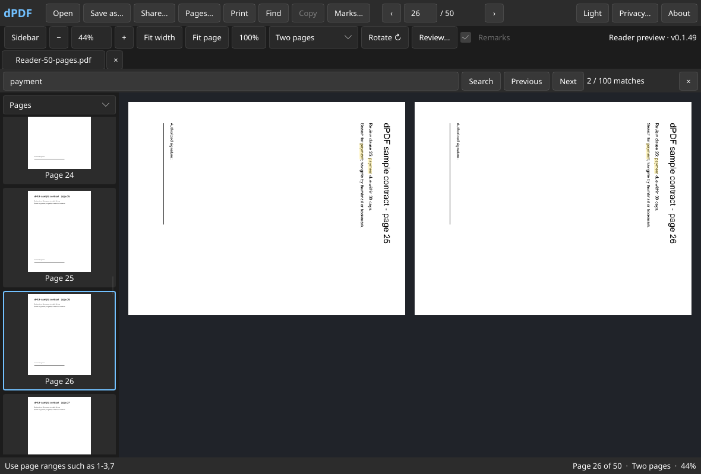

# Installed reader and search-queue qualification

Observed 7 November 2026, Fedora 45 GNOME desktop. These are synthetic reader
checks; physical printing, Windows 11 and owner Scenario A acceptance remain
separate stable-release gates.

## Installed qualified preview

Installed `dpdf-0.1.49-1.fc45.x86_64` from `zvegelj/dpdf`, COPR
[build 11270028](https://copr.fedorainfracloud.org/coprs/zvegelj/dpdf/build/11270028/).
The packaged source revision is
`1c80fd7df3e3844eae3e48cfe1fd272bb874e5a0`. The installed executable SHA256 is
`052d8aacb48b5589b7e07a6d6c8cd9d233cef5dd461493348ae3e4433d7cac8b`, matching
the qualified Fedora 45 package. System qpdf is `12.4.2-1.fc45`.

A normal reader process opened a generated 50-page PDF in the active desktop
and remained running. The installed reader's complete `--smoke-ui` diagnostic
also passed with DISPLAY removed and the native Wayland session selected:
rendering, search, facing/rotation/fit/theme, page entry, bookmarks,
byte-identical Save As, failed-destination protection, printer discovery and
invalid-range refusal. It submitted no physical print job.

The existing default PDF application remained `org.gnome.Papers.desktop` after
installation and launch. This was a fresh installation; rollback is removal of
the dpdf package, retaining per-user data. No desktop default was reassigned.

The real packaged desktop entry also launched a generated 300-page document with
a Unicode filename and a 1000-page document together. The process remained
running with both file arguments. Its observed RSS was approximately 78 MiB;
this is one observation, not a memory ceiling.

## Installed reader and clipboard checks

The exact-tag reader/search corpus, native X11 file-drop protocol test,
viewport/physical-page-layout/tabs at scale 1.5, and encrypted-PDF suite all
passed against the installed RPM. Encrypted fixtures include AES-128/AES-256,
Unicode passwords, incorrect-password retry, cancellation and unchanged copies.
Private-X11 protocol tests do not qualify real Wayland compositor drops.

In the normal GNOME session, the native Wayland reader copied selected PDF text
and its saved-file path. An independent `wl-paste` process received both; native
readback also matched. The previous text clipboard was retained only in memory
and restored. No private clipboard content was included in the saved evidence.

GNOME's existing Xwayland clipboard bridge is required by the pinned clipboard
backend in this configuration. Removing DISPLAY deliberately reproduced a
clipboard-unavailable error: this compositor does not expose the data-control
protocol used by that backend. The normal-session PASS does not imply support
for GNOME without the bridge. No compositor/security setting was changed.

## Generated-document measurements

| Generated fixture | Fresh native Wayland process to first-page + thumbnail readiness | RSS high-water mark at readiness | Headless first-page readiness |
| --- | ---: | ---: | ---: |
| 50 pages | 157 ms | 48,496 KiB | 40.6 ms |
| 300 pages, Unicode filename | 168 ms | 50,932 KiB | 20.6 ms |
| 1000 pages | 148 ms | 57,432 KiB | 33.9 ms |

Each native measurement started a fresh process/config, advised dropping only
the generated input file's cache, and stopped that diagnostic after its readiness
signal. Shared system/library caches were preserved. These are single generated
samples under a one-CPU cap, not cold-machine results, monitor presentation
latency, or representative customer-document acceptance. The complete default
50-page UI diagnostic separately passed to normal completion. The headless
benchmark also passed the geometry/cache bounds and a 50-page vector fixture;
its approximately 44-MiB renderer cache stayed below the 64-MiB budget.

## Native printing

The installed executable passed the existing real GTK print-to-file suite:
all/current/disjoint output order, Fit and Actual Size, custom UserUnit 0.5/1/2,
cancellation, protected-input refusal, unchanged source, and dispatched reader
Ctrl+P with responsive navigation. A generated 50-page raster file-print result
was 4,261,087 bytes from 33,864 source bytes, taking 13.68 seconds including
dialog interaction and validation; page 7 alone was 82,752 bytes in 1.14 seconds.
These file-printer measurements do not describe the compact CUPS transport.

Nine controlled CUPS cases passed in the separately isolated Fedora 45 receiver
with the exact installed binary/source identities: all/single/contiguous/disjoint
pages, cancellation, changed source path, forced subset-preparation fallback,
and two submission-refusal paths. All-page vector submission spooled the original
33,864 bytes in 2.10 seconds including dialog interaction. Disjoint pages
`1,7,10-12` spooled a 3,137-byte PDF in 1.71 seconds with searchable text, correct
page order and zero image XObjects. Cancellation and each controlled submission
refusal produced no job. Controlled subset-preparation refusal exercised the
confirmed raster fallback and produced the correct two pages. No external
network interface or physical printer was reachable from that test root.

The acceptance workstation had no configured physical printer. Paper output,
ruler measurement and native Windows printing remain unqualified.

## Search backpressure candidate

Application source `6623e97451ce8e0241ec6a8ba0de92f32ba1f4fd` was built once
through the established capped Rust build adapter. Its executable SHA256 is
`c8c35ee216626109d4e061b7139d1372322bc9f4a66a34a15161608379d4c67d`.
This is a distinct development candidate, not a replacement artifact for tag
v0.1.49. The installed preview executable was not overwritten.

| Check | Result |
| --- | --- |
| All Rust release tests through the capped build service | 71 passed, zero failed or filtered |
| Complete reader UI diagnostic with a deliberately full worker queue | PASS: newest search retained and completed |
| Keyboard/overflowing tabs, private X11, scale 1 and 2 | Both PASS |
| Reading position, numeric zoom and layout, private X11, scale 1 and 2 | Both PASS |

The queue diagnostic replaces an obsolete search with `payment` while the
bounded channel is full, restores the real worker, and requires the search to
complete. Unit checks also cover cancellation, changed tabs/tokens and a
disconnected worker. The X11 tests use isolated config/data and authenticated
private displays. No confidential PDFs, signature assets or recovery data were
used.

The supervised diagnostics continued after their launcher process exited and
produced a terminal success receipt. This proves that specific job survives
launcher disconnection; it does not establish reboot recovery or an automatic
project-agent continuation service. The existing COPR worker was also restarted:
it reconciled the existing releases without submitting another build, and the
v0.1.49 release receipt's hash stayed unchanged. No stable version or tag was allocated.
